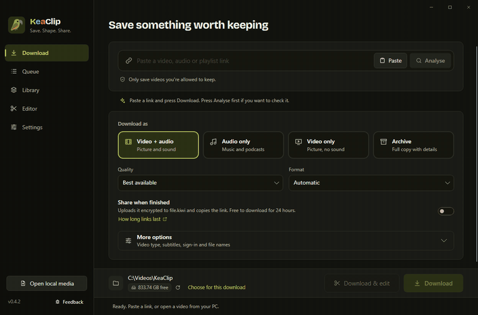
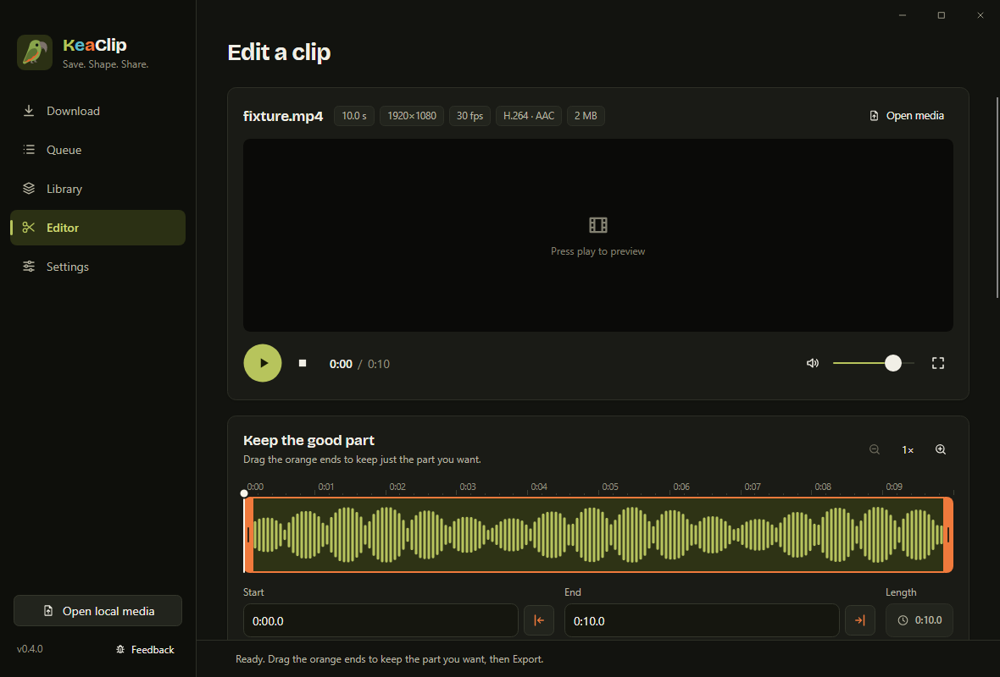
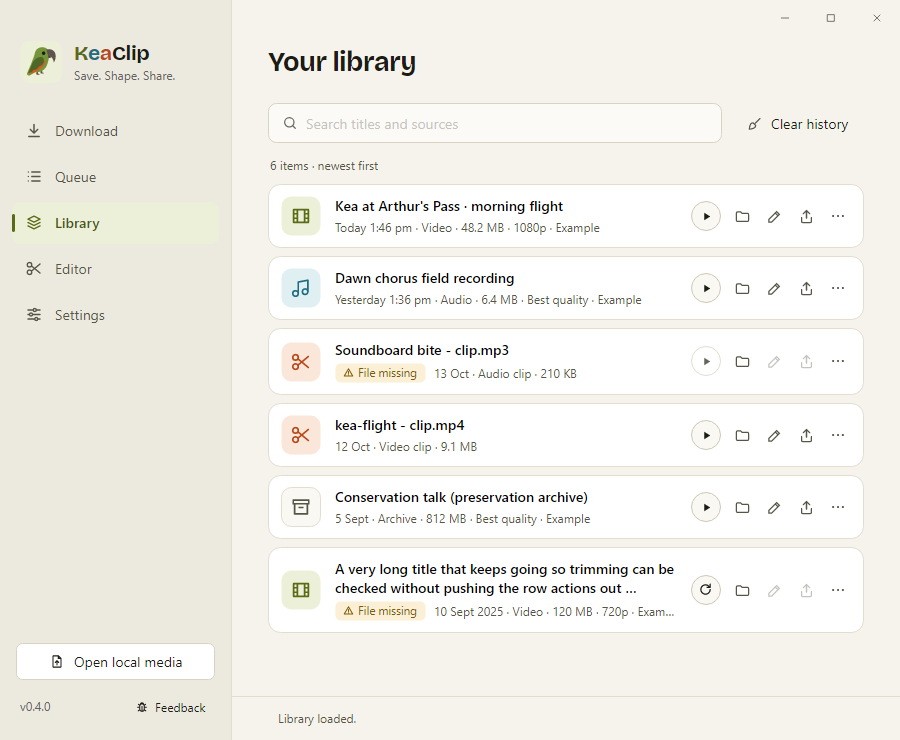

<h1 align="center">KeaClip</h1>

<b>Save it. Trim it. Share it.</b> 
A free Windows app for saving videos and audio you're allowed to keep, cutting out the good part and sending it to someone: paste it straight into Discord, or drop any files or a folder on it for one encrypted link. 
No ads, no account, no tracking.

<a href="https://github.com/Langkurst/KeaClip/releases/latest"><b>Download for Windows</b></a> · <a href="https://langkurst.github.io/KeaClip/">Website</a> · <a href="https://ko-fi.com/keaclip">Support on Ko-fi</a>

## What it does

- **Save** video or audio from a link: pick Video + audio, Audio only, Video only or a full Archive, choose quality and format, or just press Download. Playlists let you pick which videos you want, and **Just part of it** saves only the bit you need (say 0:45 to 1:20 of a long stream) without downloading the rest; a link that points to a moment (`?t=1m30s`) sets it for you.
- **Queue** as many as you like. Downloads keep going while you use the rest of the app, can be paused and retried, and your queue is still there after a restart.
- **Trim** any video or audio file: drag the orange handles, or press **Loudest 15 s** to jump straight to the action (or Last 30 s for a replay's ending), then export just that part. Make it **vertical 9:16** for TikTok, Shorts and Reels, or **louder** with one switch. Pull out the sound as MP3, fade in and out, make a short soundboard clip, or export the selection as a **GIF**.
- **Fit it for Discord** in one click: Discord (10 MB), Email (25 MB), Nitro Basic (50 MB) or Nitro (500 MB) aims the clip just under that size. Then press **Copy clip** and paste it straight into the chat with Ctrl+V, or drag it in.
- **Your game clips** are waiting when you open the Editor: new recordings from Xbox Game Bar, AMD ReLive, NVIDIA and OBS show up ready to trim.
- **Share** with an encrypted [file.kiwi](https://file.kiwi) link. Sharing uses the [file.kiwi API](https://file.kiwi/api): the file is encrypted on your PC before it uploads, and the link expires on its own. Drag any other files or a whole folder onto KeaClip to send them with one link too (several items go as one .zip, made for you).
- **Keep** everything in your Library to open, edit or share again later. Removing a record never deletes the file.

| Trim and export | Your library |
| --- | --- |
|  |  |

## Get it

KeaClip is made for Windows 11 (64-bit). Windows 10 should work but hasn't been tested yet.

1. Download the installer from the [Releases page](https://github.com/Langkurst/KeaClip/releases).
2. Run it. It installs just for you, no admin rights needed.
3. The first time it opens, KeaClip downloads the free tools it uses (yt-dlp, FFmpeg and Deno) from their official sites into its own folder. If you're offline, press **Download the tools** later. Nothing else on your PC changes.

Until KeaClip is code-signed, Windows may say "Windows protected your PC". Click **More info**, then **Run anyway**. Each download's SHA-256 is listed on the release page if you want to check the file.

## Good to know

- **Only save media you own or are allowed to keep.** KeaClip never gets around DRM or paywalls.
- **Your stuff stays on your PC.** Settings, history and any browser sign-in stay on this device. Nothing is uploaded unless you choose Share.
- **Your originals are safe.** Editing makes a new file. KeaClip only deletes an original if you tick that option, and only after the new file checks out.
- **Share links are free to download for 24 hours** (12 hours for files of 10 to 20 GB, 6 hours for 20 GB or more), then they stop working. These are file.kiwi's times for API uploads and differ from uploads made on the file.kiwi website; see [free download hours by file size](https://file.kiwi/api#free-download-hours-by-file-size).

## Privacy

KeaClip has no accounts, ads, analytics or tracking. Your files never leave your PC unless you share them. KeaClip only goes online to:

- download what you paste in, and its preview picture;
- fetch its free helper tools (yt-dlp, FFmpeg, Deno) from their official sites the first time, then check once a day for a newer yt-dlp, because websites change often (both daily checks stop if you turn off **Check for updates automatically** in Settings, About);
- check this page once a day for a new KeaClip version;
- upload a file to file.kiwi when you press Share, or after each download if you turn on Share when finished.

## Your responsibility

KeaClip is a tool, like a browser or a video player. It doesn't host, store or share anything itself, and the developer can't see or control what you save or share. You're responsible for using it legally: only download or share what you own or have permission to, and follow the copyright law where you live and the terms of the sites you use (for example YouTube and file.kiwi). KeaClip never gets around DRM, paywalls or other copy protection.

KeaClip is free software provided as is, with no warranty, under the [GNU GPL v3](LICENSE) (see sections 15 and 16). To the fullest extent the law allows, the developer isn't liable for any loss or damage from using it. Nothing here limits rights you have under laws that can't be excluded, such as New Zealand's Consumer Guarantees Act.

KeaClip isn't affiliated with or endorsed by YouTube, Discord, file.kiwi or any other site it works with. Their names belong to their owners.

## Support

KeaClip is free and always will be. If it saved you some time, you can [shout me a coffee on Ko-fi](https://ko-fi.com/keaclip). It helps me keep making it better.

Found a bug or want something added? Open an issue, or email [keaclip@proton.me](mailto:keaclip@proton.me).

## Code signing policy

Releases are unsigned for now and listed with their SHA-256 checksums. KeaClip will reapply for free code signing from SignPath.io (certificate by SignPath Foundation) once the project is better known. The full [code signing policy](https://langkurst.github.io/KeaClip/code-signing.html) lists who builds and approves each release.

## Licence

Copyright (C) 2026 Langkurst. KeaClip is free software under the [GNU GPL v3 or later](LICENSE). It's built with [Avalonia](https://avaloniaui.net), [LibVLC](https://www.videolan.org/vlc/libvlc.html), and works with [file.kiwi](https://file.kiwi/api) for sharing, [yt-dlp](https://github.com/yt-dlp/yt-dlp), [FFmpeg](https://ffmpeg.org) and [Deno](https://deno.com). Their licences ship with the app; source details are in [SOURCE.md](docs/SOURCE.md).

Building from source: see [docs/DEVELOPMENT.md](docs/DEVELOPMENT.md).
